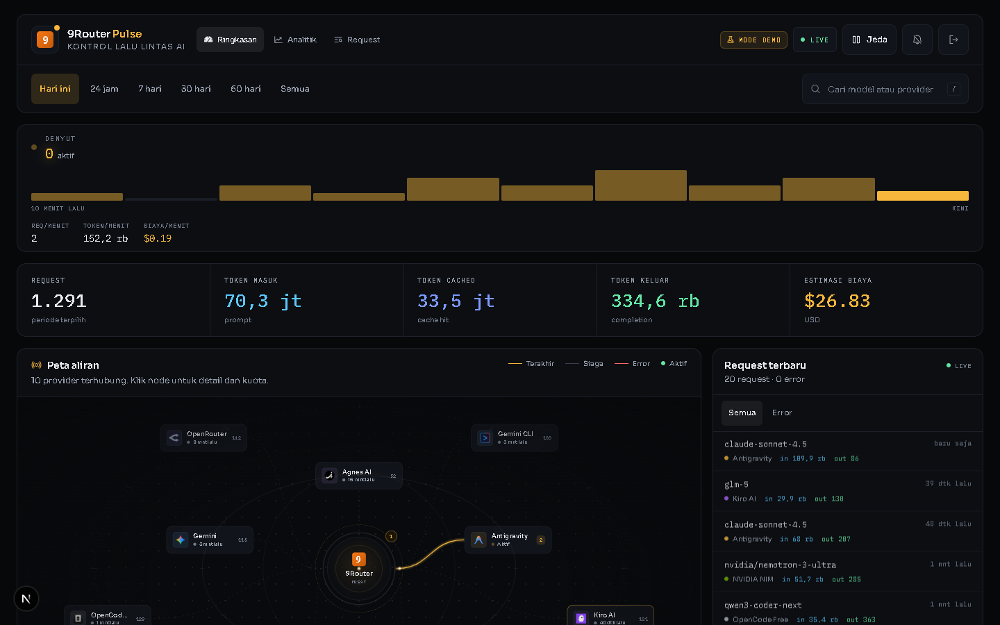
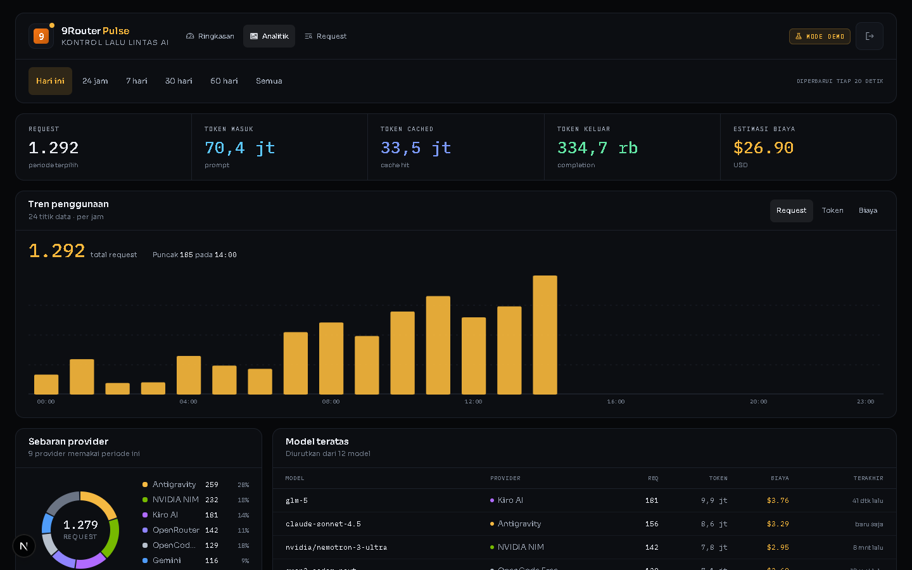
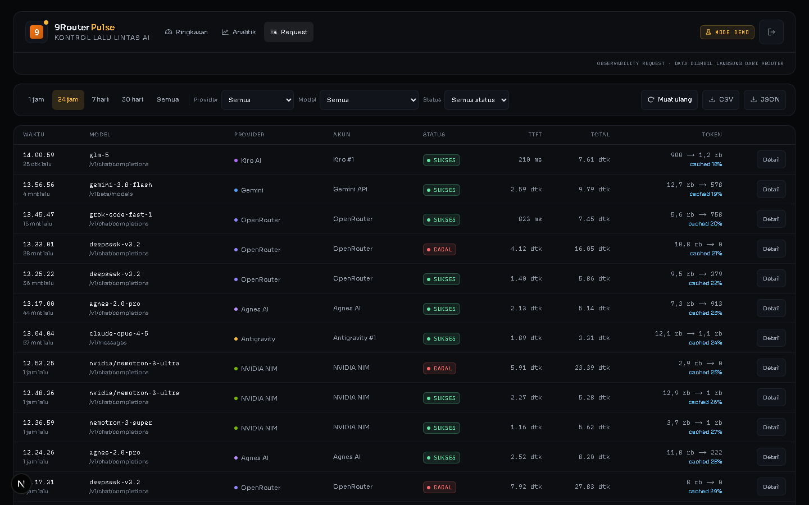

# 9Router Pulse

Dashboard interaktif untuk memantau lalu lintas 9Router secara real-time: peta aliran request dari router pusat ke provider dan model tujuan, statistik token, feed request terbaru, serta status dan kuota koneksi.

Dibangun dengan Next.js 16, React 19, Tailwind CSS 4, dan React Flow.

## Dokumentasi

- [**Setup lengkap**](docs/SETUP.md) — dari nol sampai produksi: mode demo, 9Router lokal/remote, Docker, systemd, troubleshooting.
- [**Fitur & pembeda**](docs/FEATURES.md) — daftar fitur dan bedanya dari dashboard 9Router bawaan.
- [**Arsitektur & integrasi**](docs/ARCHITECTURE.md) — cara Pulse tersambung ke 9Router (autentikasi, proxy, SSE).

## Tangkapan layar

| Ringkasan | Analitik |
|---|---|
|  |  |

| Request |
|---|
|  |

## Fitur

- Peta topologi interaktif: node provider mengorbit router pusat, garis menyala saat request sedang berjalan.
- Strip "Denyut": 10 menit terakhir dalam bar per menit, plus cincin gelombang saat provider error.
- Statistik live: request, token input, token cached, token output, dan estimasi biaya, dengan animasi count-up.
- Feed 20 request terbaru dengan pencarian model atau provider.
- Panel kesehatan provider dan drawer detail per provider.
- Halaman Analitik: tren token/biaya/request per periode, komposisi provider, liga model, akun, endpoint, dan ketersediaan model (cooldown).
- Halaman Request: penjelajah detail request dengan paginasi, filter provider/model/status/rentang waktu, drawer detail (TTFT, durasi, token, payload mentah diredaksi), dan ekspor CSV/JSON.
- Pemeriksaan kuota per koneksi, dimuat saat diminta.
- Filter periode: hari ini, 24 jam, 7 hari, 30 hari, 60 hari, semua.
- Jeda siaran live tanpa memutus koneksi data.
- Notifikasi desktop opsional saat provider error.
- Mode demo dengan data contoh berlabel jelas, berguna untuk mencoba UI tanpa instance 9Router.

## Menjalankan

Syarat: Node.js 20.9+ (kebutuhan Next.js 16) dan instance 9Router yang bisa diakses dari mesin ini.

```bash
npm install
cp .env.example .env.local   # Windows: copy .env.example .env.local
npm run dev
```

Buka `http://localhost:3210`, lalu masuk dengan password dashboard 9Router-mu.

Ingin mencoba tanpa instance 9Router? Set `NINE_ROUTER_MOCK=1` di `.env.local`, klik **Masuk mode demo** — seluruh data contoh dibuat lokal, tanpa koneksi keluar.

Produksi:

```bash
npm run build
npm start
```

Catatan: `experimental.turbopackFileSystemCacheForDev` dimatikan di `next.config.ts` sebagai workaround bug Next.js 16.4 — cache dev persisten Turbopack bisa membuat halaman reload tanpa henti setelah `next dev` di-restart (vercel/next.js#100267). Hapus opsi itu setelah bug-nya diperbaiki upstream.

## Konfigurasi

Isi `.env.local`:

```env
# URL instance 9Router, tanpa garis miring di akhir (port bawaan 9Router: 20128)
NINE_ROUTER_URL=http://localhost:20128

# 1 = data demo, 0 = konek ke 9Router asli
NINE_ROUTER_MOCK=0

# Set true hanya jika aplikasi diakses lewat HTTPS
NINE_ROUTER_COOKIE_SECURE=false
```

Saat `NINE_ROUTER_MOCK=1`, halaman login menampilkan tombol **Masuk mode demo** dan header menampilkan lencana **Mode demo**. Tidak ada request yang dikirim ke 9Router.

Saat `NINE_ROUTER_MOCK=0`, login memakai password dashboard 9Router. Password dikirim ke server lokal aplikasi ini, ditukar dengan cookie sesi `auth_token` milik 9Router, lalu password tidak disimpan. Cookie sesi berlaku 24 jam dan disimpan sebagai cookie `httpOnly` di browser.

## Cara kerja

1. `POST /api/session` memanggil `POST {NINE_ROUTER_URL}/api/auth/login` dengan password.
2. Cookie `auth_token` dari 9Router disimpan sebagai cookie `nr_session` milik aplikasi ini.
3. Route handler di `src/app/api/live/*` mem-proxy request ke API internal 9Router dengan cookie tersebut.
4. `GET /api/live/stream` mem-proxy SSE `GET /api/usage/stream` dari 9Router ke browser.
5. Klien menggabungkan statistik periode dari REST dengan field live dari SSE: `activeRequests`, `recentRequests`, `errorProvider`, `pending`. Agregat periode disegarkan lewat REST setiap 6 detik saat siaran aktif.

Tidak ada token atau password yang pernah dikirim ke browser.

## Endpoint internal yang dipakai

- `POST /api/auth/login`
- `GET /api/auth/status`
- `GET /api/usage/stream` (SSE)
- `GET /api/usage/stats?period=today|24h|7d|30d|60d|all`
- `GET /api/usage/chart?period=...`
- `GET /api/usage/request-details?page&pageSize&provider&model&status&startDate&endDate`
- `GET /api/models/availability`
- `GET /api/providers`
- `GET /api/provider-nodes`
- `GET /api/usage/[connectionId]` (kuota, saat diminta)

## Struktur

```text
src/
  app/
    api/session/route.ts          login, status, logout
    api/live/stream/route.ts      proxy SSE
    api/live/stats/route.ts       proxy statistik
    api/live/chart/route.ts       proxy grafik penggunaan
    api/live/availability/route.ts proxy ketersediaan model
    api/live/requests/route.ts    proxy detail request (paginasi + filter)
    api/live/requests/export/     ekspor CSV/JSON
    api/live/providers/route.ts   proxy daftar koneksi
    api/live/quota/[id]/route.ts  proxy kuota
    login/                        halaman login
    page.tsx                      dashboard (Ringkasan)
    analytics/page.tsx            analitik penggunaan
    requests/page.tsx             penjelajah request
  components/dashboard/           topology, statistik, feed, drawer, denyut
  components/analytics/           panel tren, provider, model, akun, endpoint
  components/requests/            tabel + drawer detail request
  hooks/                          SSE, analitik, request, sesi, provider
  lib/                            tipe, helper, mock, klien 9Router
```

## Keamanan

- Password tidak ditulis ke disk dan tidak di-log.
- Sesi disimpan di cookie `httpOnly`, `sameSite=lax`.
- Route API menolak request tanpa cookie sesi.
- Aplikasi ini ditujukan untuk penggunaan pribadi di mesin lokal. Jika di-deploy ke publik, tambahkan lapisan autentikasi sendiri dan set `NINE_ROUTER_COOKIE_SECURE=true`.

## Kredit

- Ikon provider berasal dari proyek [9Router](https://github.com/decolua/9router) (MIT).
- Nama dan merek provider adalah milik masing-masing pemiliknya.
